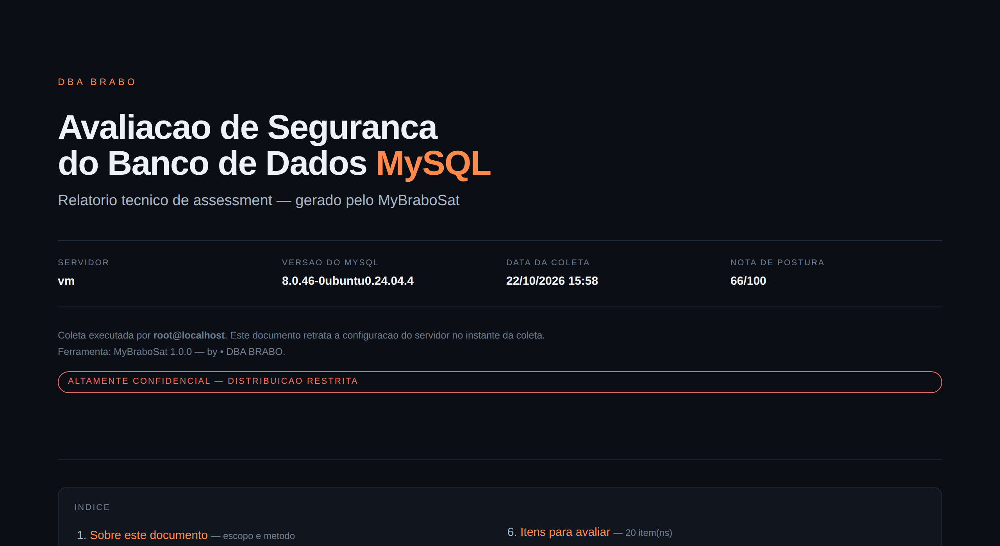
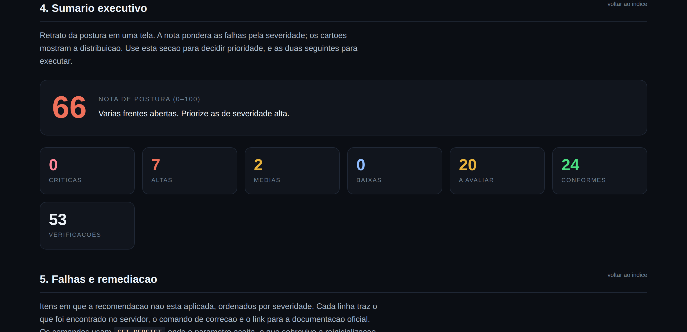
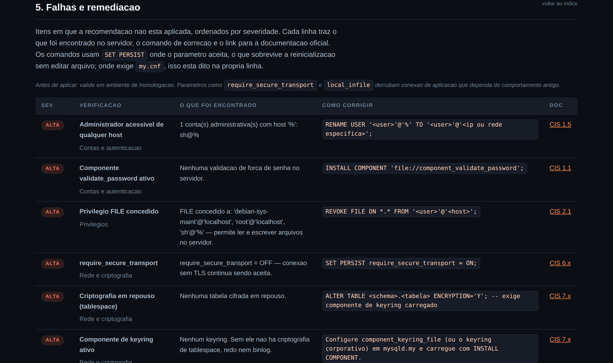
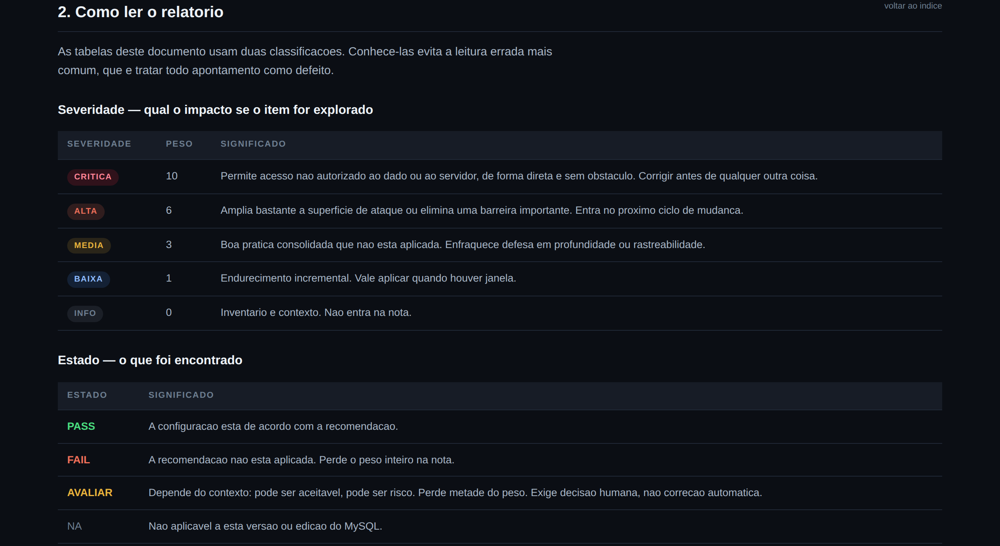

<div align="center">

```
██████╗ ██████╗  █████╗     ██████╗ ██████╗  █████╗ ██████╗  ██████╗
██╔══██╗██╔══██╗██╔══██╗    ██╔══██╗██╔══██╗██╔══██╗██╔══██╗██╔═══██╗
██║  ██║██████╔╝███████║    ██████╔╝██████╔╝███████║██████╔╝██║   ██║
██║  ██║██╔══██╗██╔══██║    ██╔══██╗██╔══██╗██╔══██║██╔══██╗██║   ██║
██████╔╝██████╔╝██║  ██║    ██████╔╝██║  ██║██║  ██║██████╔╝╚██████╔╝
╚═════╝ ╚═════╝ ╚═╝  ╚═╝    ╚═════╝ ╚═╝  ╚═╝╚═╝  ╚═╝╚═════╝  ╚═════╝
```

# MyBraboSat

**MySQL Security Assessment — nível enterprise, em um único arquivo `.sql`**

[](https://dev.mysql.com/doc/refman/8.4/en/security.html)
[](LICENSE)
[](#dom%C3%ADnios-cobertos)
[](#seguran%C3%A7a-da-pr%C3%B3pria-coleta)
[](#requisitos)

_by • **DBA BRABO**_ · [dbabrabo.com.br](https://dbabrabo.com.br)

</div>

---

Roda no cliente `mysql` de linha de comando, não instala nada, não altera nada no servidor,
e devolve um **relatório HTML autocontido** — CSS embutido, sem arquivo ao lado, sem CDN,
sem internet. O mesmo arquivo vira um **documento de assessment em PDF** com um clique.

```bash
mysql -u auditor -p --skip-column-names -f < mybrabosat.sql > MyBraboSat.html
```

É isso. Um comando, um arquivo, 53 verificações.

<div align="center">
  
</div>

> 📄 **Veja o documento completo:** [`docs/MyBraboSat-assessment.pdf`](docs/MyBraboSat-assessment.pdf) — 17 páginas, capa, índice, rodapé em toda página.
> 🌐 **Veja o HTML interativo:** [abrir no navegador](https://htmlpreview.github.io/?https://github.com/acaciolr/mybrabosat/blob/main/docs/exemplo-MyBraboSat.html) · ou baixe [`docs/exemplo-MyBraboSat.html`](docs/exemplo-MyBraboSat.html)

---

## Sumário

- [Por dentro do relatório](#por-dentro-do-relatório)
- [Como gerar](#como-gerar)
- [Requisitos](#requisitos)
- [Do HTML para o PDF](#do-html-para-o-pdf)
- [Domínios cobertos](#domínios-cobertos)
- [Nota de postura](#nota-de-postura)
- [Estrutura do documento](#estrutura-do-documento)
- [Segurança da própria coleta](#segurança-da-própria-coleta)
- [Diferenças em relação ao MySAT](#diferenças-em-relação-ao-mysat)
- [Validação](#validação)
- [Crédito e licença](#crédito-e-licença)

---

## Por dentro do relatório

**Sumário executivo** — nota de postura de 0 a 100 e contagem por severidade, antes de qualquer detalhe técnico:

<div align="center">
  
</div>

**Falhas e remediação** — cada achado traz o que foi encontrado *naquele servidor*, o comando de correção pronto e o link para a documentação oficial:

<div align="center">
  
</div>

**Legendas em tudo** — severidades, estados e o que cada seção cobre, para o relatório ser lido por quem não escreveu a query:

<div align="center">
  
</div>

---

## Como gerar

Clone ou baixe só o `.sql`:

```bash
git clone https://github.com/acaciolr/mybrabosat.git
cd mybrabosat
# ou, só o script:
curl -LO https://raw.githubusercontent.com/acaciolr/mybrabosat/main/mybrabosat.sql
```

### Servidor local

```bash
mysql -u auditor -p --skip-column-names -f < mybrabosat.sql > MyBraboSat.html
```

### Servidor remoto, com TLS

```bash
mysql -h db.exemplo.com.br -P 3306 -u auditor -p \
      --ssl-mode=REQUIRED \
      --skip-column-names -f < mybrabosat.sql > MyBraboSat.html
```

### Nome do arquivo com host e data

```bash
HOST=db-prod-01
mysql -h "$HOST" -u auditor -p --skip-column-names -f < mybrabosat.sql \
  > "MyBraboSat-${HOST}-$(date +%Y%m%d).html"
```

### Vários servidores de uma vez

```bash
for H in db-prod-01 db-prod-02 db-hml-01; do
  mysql -h "$H" -u auditor -p"$SENHA" --skip-column-names -f < mybrabosat.sql \
    > "MyBraboSat-${H}-$(date +%Y%m%d).html"
done
```

### Abrir o resultado

```bash
xdg-open MyBraboSat.html   # Linux
open MyBraboSat.html       # macOS
start MyBraboSat.html      # Windows
```

> **As flags não são opcionais.**
> `--skip-column-names` tira o cabeçalho de coluna que o cliente imprimiria no meio do HTML.
> `-f` mantém a execução quando uma verificação não se aplica à versão do servidor.

---

## Requisitos

- **MySQL 8.0 ou superior.** Validado em 8.0; as verificações já cobrem as mudanças do 8.4
  (`authentication_policy`, remoção de `default_authentication_plugin`, fim de `have_ssl`).
- **Cliente `mysql`** de linha de comando. Nada além disso: sem Python, sem Perl, sem agente.
- **Uma conta de leitura.** Não precisa de `SUPER`, não precisa de root.

Conta de auditoria dedicada, sem poder de escrita:

```sql
CREATE USER 'auditor'@'10.0.0.%' IDENTIFIED BY '<senha forte>';
GRANT SELECT, PROCESS ON *.* TO 'auditor'@'10.0.0.%';
GRANT CREATE TEMPORARY TABLES ON sys.* TO 'auditor'@'10.0.0.%';
```

| Privilégio | Para quê |
| --- | --- |
| `SELECT` em `*.*` | ler `mysql.user`, `information_schema`, `performance_schema` |
| `PROCESS` | inventário de engines e tablespaces |
| `CREATE TEMPORARY TABLES` em `sys` | a tabela de achados da sessão |

---

## Do HTML para o PDF

O relatório **já é** o documento. Não há segundo comando, segundo arquivo nem biblioteca de PDF.

1. Rode o `.sql` → sai o `MyBraboSat.html`
2. Abra no navegador
3. Clique em **Salvar em PDF** (canto inferior direito) → cai na caixa de impressão
4. Destino: **Salvar como PDF** → salve

O `@media print` cuida do resto: o tema vira claro, o botão some, cada seção começa em
página nova, o rodapé com servidor/data/confidencialidade se repete em toda página e
nenhuma linha de tabela é partida ao meio. Os links continuam clicáveis dentro do PDF.

> Mantenha **"Cabeçalhos e rodapés"** marcado na caixa de impressão: é de lá que vem a paginação.

Headless, para pipeline:

```bash
google-chrome --headless --disable-gpu --no-pdf-header-footer \
  --print-to-pdf=MyBraboSat.pdf MyBraboSat.html
```

---

## Domínios cobertos

**53 verificações**, agrupadas em seis domínios:

| Domínio | O que é olhado |
| --- | --- |
| 🔐 **Contas e autenticação** | conta sem senha, conta anônima, `root` acessível de qualquer host, `mysql_native_password`, `authentication_policy`, componente `validate_password`, expiração e histórico de senha, bloqueio por tentativas, uso de roles |
| 🛡️ **Privilégios** | `FILE`, `GRANT OPTION`, escrita no dicionário, `partial_revokes`, rotinas com `DEFINER` privilegiado, `DEFINER` órfão |
| 🔑 **Rede e criptografia** | TLS ativo, `require_secure_transport`, versões de TLS aceitas, criptografia em repouso, componente de keyring, redo/undo/binlog cifrados |
| ⚙️ **Configuração segura** | `local_infile`, `secure_file_priv`, symlinks, `skip_name_resolve`, X Protocol, `sql_mode`, schema `test` remanescente, engine fora do InnoDB |
| 📋 **Log e auditoria** | error log, componente de auditoria, general log, binlog e retenção, `performance_schema` |
| 🇧🇷 **Dados sensíveis / LGPD** | colunas candidatas a dado pessoal, possível segredo em texto claro, tabelas sem chave primária |

Cada verificação tem severidade (**crítica**, **alta**, **média**, **baixa**), estado
(**OK**, **FAIL**, **AVALIAR**, **N/A**), comando de remediação e link para a
documentação oficial do MySQL — mais a referência CIS quando existe.

---

## Nota de postura

| Severidade | Peso |
| --- | --- |
| Crítica | 10 |
| Alta | 6 |
| Média | 3 |
| Baixa | 1 |

`FAIL` perde o peso inteiro. `AVALIAR` perde metade. `OK` e `N/A` não perdem nada.

```
nota = 100 × (1 − perdido / total)
```

A nota existe para comparar o **mesmo servidor ao longo do tempo** e priorizar o que atacar
primeiro. Não é selo de conformidade, e o relatório diz isso na seção de limitações.

---

## Estrutura do documento

| # | Seção | Para quem |
| --- | --- | --- |
| — | **Capa** | servidor, versão, data da coleta, nota, classificação de confidencialidade |
| — | **Índice** | em página própria, com a contagem de cada seção |
| 1 | Sobre este documento | escopo, método e o que está **fora** do escopo |
| 2 | Como ler o relatório | legenda de severidades (com peso) e de estados |
| 3 | Segurança em MySQL | por que o tema importa, os quatro eixos e o recorte da LGPD |
| 4 | **Sumário executivo** | gestão: nota e contagem por severidade |
| 5 | **Falhas e remediação** | DBA: o que corrigir, com o comando |
| 6 | Itens para avaliar | o que depende do contexto da aplicação, separado das falhas |
| 7 | Todas as verificações | evidência de cobertura, inclusive o que passou |
| 8 | Inventário | versão, contas, schemas, maiores tabelas, parâmetros de segurança |
| 9 | Limitações e próximos passos | o que a ferramenta não vê |
| 10 | Referências | manual do MySQL, CIS Benchmark, CVE Details, LGPD |

Toda seção abre com uma legenda explicando o que ela cobre e como lê-la.

---

## Segurança da própria coleta

- **Somente leitura.** Nenhum `INSERT`, `UPDATE`, `DELETE` ou `ALTER` em objeto do servidor.
- O único objeto criado é uma **tabela temporária de sessão** em `sys`, que desaparece ao desconectar.
- **Nenhum dado de aplicação é lido.** A verificação de dado pessoal olha o *dicionário* —
  nomes de coluna — nunca o conteúdo das tabelas.
- **Nenhuma senha aparece no relatório.** Hashes de autenticação não são impressos.
- Saída local: nada é enviado para lugar nenhum.

O relatório nasce marcado como **ALTAMENTE CONFIDENCIAL** — ele é um mapa das fraquezas
do servidor. Trate o arquivo como trata o `my.cnf`.

---

## Diferenças em relação ao MySAT

O [MySAT](https://github.com/meob/MySAT) escreve HTML direto na saída, um `select` por
verificação. O MyBraboSat grava cada achado numa **tabela temporária** e só depois monta o
relatório — é isso que permite sumário executivo, nota de risco e lista de falhas ordenada
por severidade, nenhum dos três possível quando a saída é um fluxo.

| | MySAT | MyBraboSat |
| --- | --- | --- |
| Arquivos de saída | `.htm` + `mysat.css` ao lado | **um único `.html`** |
| Sumário executivo | — | nota 0–100 + contagem por severidade |
| Falhas separadas do resto | — | seção própria, ordenada por severidade |
| Comando de remediação | — | em toda falha, com `SET PERSIST` onde cabe |
| Link para a doc oficial | parcial | em toda verificação |
| Índice navegável | — | sim, com contagem por seção |
| PDF de assessment | — | capa, rodapé fixo, quebra por seção |
| Checks de 8.0/8.4 | versão de 2018 | `authentication_policy`, keyring, `audit_log`, `partial_revokes`, fim de `default_authentication_plugin` |

---

## Validação

- Executado contra um **MySQL 8.0.46 real**: sem erro, sem warning.
- **Teste negativo**: conta sem senha, conta anônima e `mysql_native_password` criados de
  propósito para confirmar que os checks disparam — e disparam.
- Saída renderizada em **Chromium headless**: todas as âncoras do índice resolvem, o modo de
  impressão foi conferido e o PDF sai com 17 páginas A4 sem linha de tabela partida.

---

## Crédito e licença

Derivado do **[MySAT — MySQL Security Assessment Tool](https://github.com/meob/MySAT)**,
de XeniaLAB srl (meo@bogliolo.name), licença MIT. O crédito está também no cabeçalho do
`.sql` e na seção de referências do relatório.

Este trabalho é MIT — [`LICENSE`](LICENSE).
Copyright © 2026 **DBA BRABO**.

---

<div align="center">

**DBA BRABO** · mentoria, bootcamps e labs de banco de dados
[dbabrabo.com.br](https://dbabrabo.com.br) · [LinkedIn](https://www.linkedin.com/in/acaciolr/)

</div>
